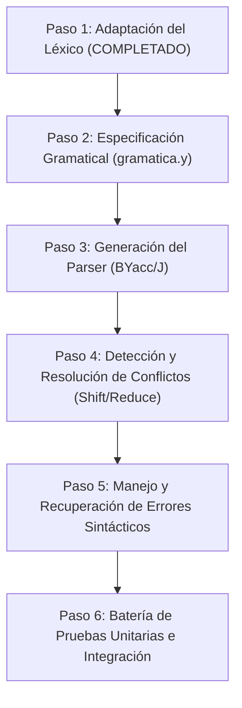

# TP2_PLAN.md - Plan de Trabajo y Adaptación para el Parser (TP2)

**Compiladores e Intérpretes - 2026**  
**Grupo:** 34  
**Temas Asignados:** 2, 8, 9, 11, 16, 18, 20, 23, 27, 29, 30, 35  

---

## 1. Lenguaje y Herramientas de Desarrollo

- **Lenguaje Base:** Java (OpenJDK 21+ / JVM)
- **Generador de Parser:** **BYacc/J** (`yacc -J` o binario `byacc` con soporte Java).
- **Mecanismo de Interfaz Léxico-Sintáctico:**
  - El Parser invoca repetidamente el método `public int yylex()` de `AnalizadorLexico`.
  - La comunicación de atributos semánticos se realiza a través de la variable pública `public ParserVal yylval`.
  - El puntero/referencia a la entrada correspondiente en la Tabla de Símbolos se entrega en `yylval.obj` (como objeto `RegistroTS`) y el lexema String en `yylval.sval`.
  - El final de la entrada se notifica cuando `yylex()` retorna `0` (EOF).
  - La sincronización y reporte de errores sintácticos/léxicos se apoya en el contador `public int yylineno`.

---

## 2. Inventario de Tokens y Símbolos del Grupo 34

### A. Tipos de Datos y Literales con Atributo
- `ID` (257): Identificadores alfanuméricos con truncamiento a 22 caracteres.
- `CTE_ENTERA` (258): Constantes enteras cortas sin signo de 8 bits con sufijo `$us` (rango 0 a 255) (**Tema 2**).
- `DOUBLEF_VAL` (259): Constantes reales de punto flotante de 64 bits con notación exponencial opcional `d`/`d+`/`d-` (**Tema 8**).
- `CADENA` (260): Cadenas de caracteres de una sola línea delimitadas por llaves `{ ... }` (**Tema 9**).

### B. Palabras Reservadas
- **Estructura y Control:**
  - `IF` (270), `THEN` (281), `ELSE` (272), `END_IF` (273)
  - `WHILE` (282), `REPEAT` (283) (**Tema 11**)
  - `BEGIN` (274), `END` (275)
  - `POUT` (276)
  - `RET` (277)
  - `CLASS` (278), `FUNCTION` (279)
  - `TYPEDEF` (284) (**Tema 23**)
  - `PRIVATE` (285), `FRIEND` (286) (**Tema 27**)
  - `EXTENDS` (287) (**Tema 30**)
- **Tipos de Datos:**
  - `USHORTINT` (279) (**Tema 2**)
  - `DOUBLEF` (280) (**Tema 8**)
- **Conversiones Explícitas del Grupo:**
  - `TODF` (288) (Conversión a flotante 64 bits para grupos con Tema 8 / Tema 33).
  - `TOUS` (289) (Conversión a entero sin signo 8 bits para grupos con Tema 2 / Tema 34).

### C. Operadores Compuestos y Comparadores
- `MAYOR_IGUAL` (261): `>=`
- `MENOR_IGUAL` (262): `<=`
- `IGUAL_IGUAL` (263): `==`
- `DISTINTO` (264): `!=`
- `ASIGNACION` (265): `:=`
- `MAYOR` (62): `>` (código ASCII)
- `MENOR` (60): `<` (código ASCII)

### D. Delimitadores y Símbolos Simples (Códigos ASCII directos)
- `'('` (40), `')'` (41), `','` (44), `';'` (59)
- `':'` (58)
- `'='` (61) (Utilizado en asignación en expresiones, **Tema 18**, y definiciones)
- `'.'` (46) (Acceso a miembros/atributos de clase)
- `'['` (91), `']'` (93) (Corchetes para orden de parámetros **Tema 20**, enumeraciones **Tema 23** y acceso posicional **Tema 29**)
- `'+'` (43), `'-'` (45), `'*'` (42), `'/'` (47) (Operadores aritméticos)

### E. Comentarios y Espacios Descartados
- `{{ ... }}`: Comentarios multilínea descartados en su totalidad, actualizando adecuadamente `yylineno` (**Tema 16**).
- Blancos, tabuladores y saltos de línea (`\r`, `\n`) descartados automáticamente.

---

## 3. Plan de Trabajo por Etapas para el Parser del TP2

### Detalle de las Etapas:

1. **Etapa 1: Adaptación del Léxico (Completado):**
   - Implementación de `yylex()` y `yylval` con puntero `RegistroTS`.
   - Incorporación de todos los símbolos (`[`, `]`, `:`, `.`), operadores y palabras reservadas asignadas.
   - Verificación unitaria exitosa con `PruebaLexicoTP2.java`.

2. **Etapa 2: Especificación Gramatical (`gramatica.y`):**
   - Definición de declaraciones `%token` con nombres y tipos.
   - Declaraciones de precedencia y asociatividad (`%left`, `%right`) para operadores aritméticos y relacionales.
   - Definición de reglas para estructura de programa, clases, herencia múltiple (`extends`), miembros privados y clases amigas (`friend`, `private`).
   - Definición de funciones, tipos definidos por usuario (`typedef`), sentencias ejecutables (`while repeat`, `if then else end_if`, `pout`, `ret`).
   - Soporte sintáctico para asignaciones en expresiones (`Tema 18`), orden de parámetros con corchetes (`Tema 20`) y acceso posicional (`Tema 29`).

3. **Etapa 3: Generación y Resolución de Conflictos:**
   - Compilación con BYacc/J (`byacc -J -v gramatica.y`).
   - Inspección del archivo `y.output` para detectar y erradicar cualquier conflicto shift-reduce y reduce-reduce.

4. **Etapa 4: Tratamiento de Errores Sintácticos y Recuperación:**
   - Incorporación de reglas con el token `error` y punto y coma / fin de bloque para permitir la continuación del parsing ante sentencias erróneas.
   - Mensajes descriptivos indicando número de línea vía `yylineno`.

5. **Etapa 5: Pruebas de Integración y Reportes:**
   - Creación de casos de prueba con sintaxis correcta que abarquen todos los temas del Grupo 34.
   - Casos de prueba con errores sintácticos intencionales para verificar robustez y recuperación.
